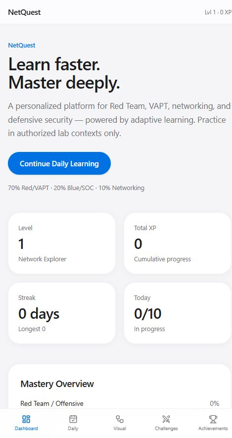
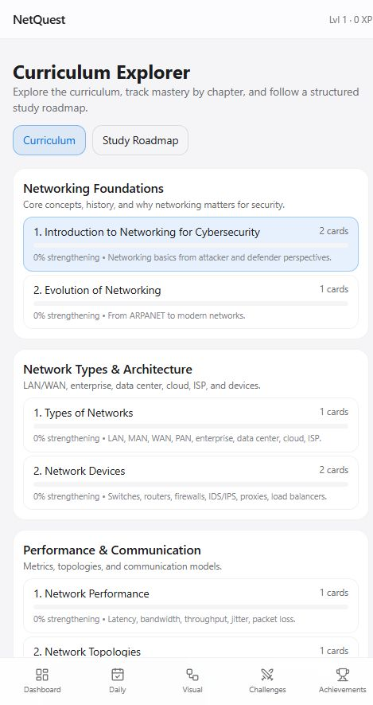
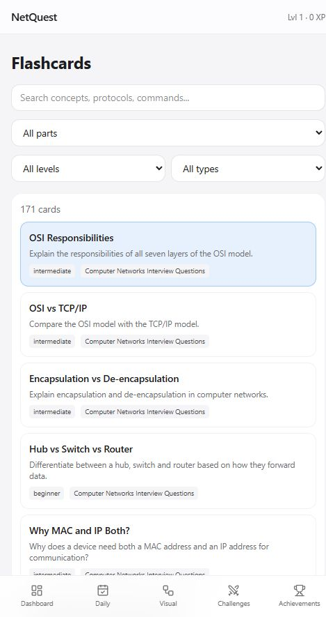
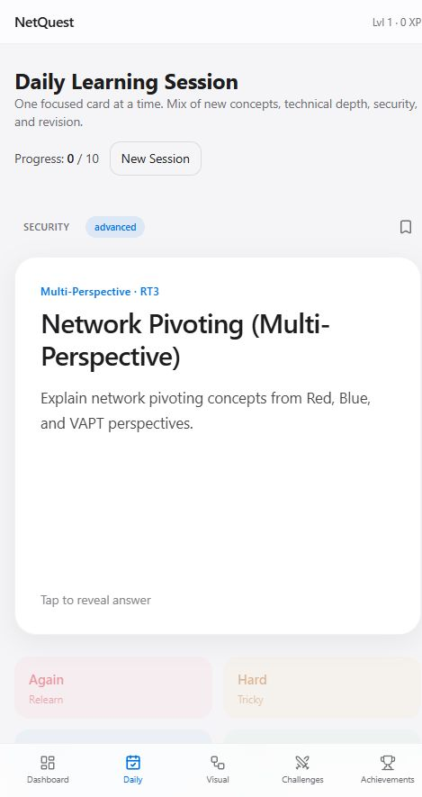
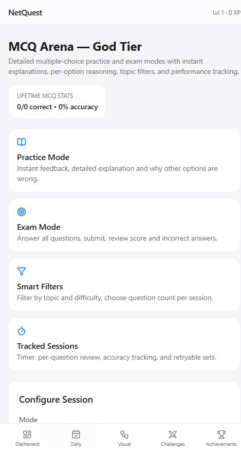
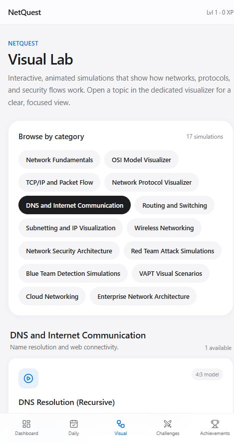
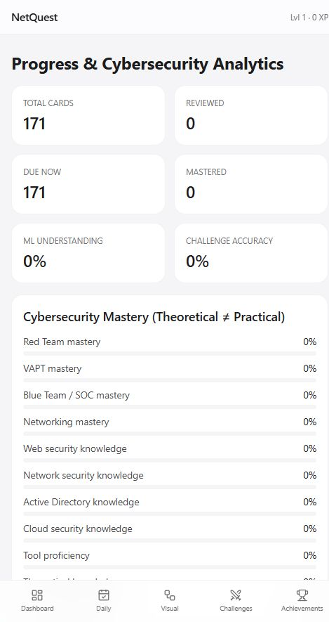

<div align="center">

# NetQuest

**A local-first, data-driven platform for networking & cybersecurity mastery**

[](https://github.com/r4tnadeepbose/NetQuest/actions/workflows/deploy.yml)
[](LICENSE)
[](https://react.dev/)
[](https://www.typescriptlang.org/)
[](https://vite.dev/)
[](https://tailwindcss.com/)

**[Live Demo](https://r4tnadeepbose.github.io/NetQuest/)** · **[Report an Issue](https://github.com/r4tnadeepbose/NetQuest/issues)** · **[Request a Feature](https://github.com/r4tnadeepbose/NetQuest/issues)**

</div>

---

## Overview

NetQuest is a **client-side, offline-capable learning application** built to help learners build deep, practical understanding of **computer networking and cybersecurity**. It combines a structured, data-driven curriculum with **spaced repetition (SRS)**, **on-device ML personalization**, an adaptive daily learning engine, interview preparation, MCQ assessment, challenges/labs, Red & Blue team tracks, and an interactive **Visual Lab/Visualizer** for animated protocol and network simulations.

There is **no backend**: progress, preferences, and study state are persisted locally in the browser, making the app private by default and trivially deployable as a static site (including GitHub Pages).

> **Safety & ethics:** Practical/offensive content is included strictly for **authorized, isolated lab environments** and defensive understanding. `sidenav.html` is preserved as part of the project.

---

## Screenshots

| Dashboard | Curriculum | Flashcards |
|:--:|:--:|:--:|
|  |  |  |

| Daily Learning | MCQ Arena | Visual Lab | Progress |
|:--:|:--:|:--:|:--:|
|  |  |  |  |

---

## Key Features

- **Structured curriculum** — Parts/chapters covering networking foundations through advanced topics (OSI/TCP-IP, addressing/subnetting, routing & switching, protocols, wireless, enterprise/cloud, security, forensics/SOC/VAPT), plus **Interview Mega Pack**, **OWASP Top 10**, and security standards (WSTG/ASVS/MASVS context).
- **Flashcards with SRS** — Flip cards with Again/Hard/Good/Easy ratings, simplified SM-2-inspired scheduling, review states, and domain-aware study.
- **Adaptive daily learning engine** — Personalized daily sessions (default distribution **70% Red/VAPT, 20% Blue/SOC, 10% networking**, adaptive/rotational) prioritizing SRS-due items, weaknesses, and lapses.
- **On-device personalization (ML)** — Lightweight online logistic regression + EMA signals (`progress.ml`) to model understanding and tune selection without sending data off-device.
- **MCQ Arena** — Topic-based multiple-choice questions with explanations and per-option “why not” reasoning (including interview/modern networking coverage).
- **Challenges & Interactive Labs** — Scenario-driven practice and guided lab-style learning modules.
- **Red Team / Blue Team / Tools / Tracks / Capstones** — Dedicated learning paths, tooling knowledge, multi-track progression, and capstone experiences (defensive and authorized offensive perspectives).
- **Visual Lab & Visualizer** — Browsable catalog of event-driven, animated simulations (packets/arrows, play/pause/step/speed/loop, device/packet inspection, beginner/advanced views, timelines) with deep links (e.g. `#/visualizer?sim=...`) and “Open in Visual Lab/Visualizer” flows from study content. 4:3 landscape stage with a no-scroll split visualizer layout.
- **Progress, XP & achievements** — Streaks, levels/XP, bookmarks, domain/cyber metrics, achievements, and analytics.
- **Polished UX** — Apple-inspired responsive UI, sound effects and full-page confetti celebrations (with toggles), toasts, and error boundaries around visual routes.
- **Settings & safety controls** — Learning path/distribution preferences, sound/effects toggles, and a single **“Reset Everything”** action to clear all progress.
- **GitHub Pages–ready** — Static build, `HashRouter`, relative asset base, SPA fallback, and CI/CD workflow for zero-config hosting.

---

## Tech Stack

| Layer | Technology |
|---|---|
| Framework | [React 19](https://react.dev/) + [TypeScript](https://www.typescriptlang.org/) |
| Build tooling | [Vite 8](https://vite.dev/), `@vitejs/plugin-react` |
| Styling | [Tailwind CSS v4](https://tailwindcss.com/) (`@tailwindcss/vite`) |
| Routing | [React Router v7](https://reactrouter.com/) (`HashRouter` for static hosting) |
| UI/Animation | [Framer Motion](https://www.framer.com/motion/), [Lucide React](https://lucide.dev/) icons |
| Linting | [Oxlint](https://oxc.rs/docs/guide/usage/linter.html) |
| Persistence | Browser `localStorage` (no backend) |
| CI/CD | GitHub Actions → GitHub Pages |

---

## Architecture & Design Notes

- **Data-driven content:** Curriculum, flashcards, MCQs, interview/standards packs, and Visual Lab simulations are defined in `src/data/*` and `src/vislab/*` for easy extension and review.
- **State & engines:** `src/store.tsx` centralizes app progress, SRS/ML state, adaptive daily selection, and domain metrics; `src/lib/srs.ts` and `src/lib/ml.ts` implement scheduling and on-device modeling.
- **Simulation engine:** `src/vislab/engine.tsx` + `src/vislab/catalog.ts` provide an event-driven player, layout modes, inspection, and a catalog of network/protocol/security visualizations.
- **Resilience:** `ErrorBoundary` guards visual routes; celebrations/SFX are preference-gated.
- **Static-host friendly:** Relative base (`./`), hash-based routing, `public/404.html`, and `.nojekyll` ensure correct behavior under GitHub Pages project paths.

### Routes (high level)

`/` Dashboard · `/daily` Daily Learning · `/flashcards` · `/curriculum` · `/visual-lab` & `/visualizations` · `/visualizer?sim=<id>` (standalone) · `/red-team` · `/blue-team` · `/tools` · `/tracks` · `/capstones` · `/challenges` · `/mcq` · `/labs` · `/progress` · `/achievements` · `/settings`

---

## Project Structure

```text
.
├─ .github/workflows/deploy.yml   # GitHub Pages CI/CD (build + deploy dist)
├─ docs/screenshots/              # README screenshots
├─ public/                        # Static assets, 404 fallback, .nojekyll
├─ src/
│  ├─ components/                 # Layout, effects, flashcard view, UI primitives
│  ├─ data/                       # Curriculum, MCQs, interview/OWASP/security packs
│  ├─ lib/                        # SRS, ML, SFX, utilities
│  ├─ pages/                      # Route-level views (Dashboard, Visualizer, etc.)
│  ├─ vislab/                     # Simulation engine, types, catalog
│  ├─ store.tsx                   # Global state, persistence, adaptive engine
│  ├─ App.tsx                     # Router & providers
│  └─ main.tsx                    # Entry point
├─ index.html
├─ run.py                         # One-stop local runner
├─ sidenav.html                   # Preserved project file
├─ vite.config.ts
├─ tsconfig*.json
├─ LICENSE                        # MIT
└─ README.md
```

---

## Local Persistence

| Key | Purpose |
|---|---|
| `netquest_progress_v1` | Progress, reviews/SRS state, XP/streaks, achievements, daily session, ML/cyber metrics |
| `netquest_mcq_stats_v1` | MCQ performance statistics |
| `netquest_prefs_v1` | User preferences (e.g. sound/effects) |

Use **Settings → Reset Everything** to clear progress/state (preferences may be managed separately per implementation).

---

## Getting Started

### Prerequisites

- **Node.js** 20+ and **npm**
- *(Optional)* **Python 3** for `run.py`

### Install & run

```bash
# Clone
git clone https://github.com/r4tnadeepbose/NetQuest.git
cd NetQuest

# Install
npm install

# Start dev server
npm run dev
```

Or:

```bash
python run.py
```

### Available scripts

| Command | Description |
|---|---|
| `npm run dev` | Start Vite dev server |
| `npm run build` | Type-check (`tsc -b`) and build production bundle |
| `npm run preview` | Preview the production build locally |
| `npm run lint` | Run Oxlint |

---

## Deployment (GitHub Pages)

This repository is configured for **automatic deployment** via GitHub Actions.

1. Push to `main` (or `master`) on GitHub.
2. In **Settings → Pages → Build and deployment → Source**, select **GitHub Actions**.
3. The workflow [`.github/workflows/deploy.yml`](.github/workflows/deploy.yml) builds and publishes `dist` to Pages.
4. Once the action succeeds, the app is available at: **https://r4tnadeepbose.github.io/NetQuest/**

**Notes**
- Hash routing + relative base ensure correct asset/route resolution under project Pages paths.
- `public/404.html` and `public/.nojekyll` improve SPA/static hosting behavior.
- If Pages was previously set to *Deploy from a branch*, switch to *GitHub Actions* for this Vite build.

---

## Content & Extensibility

- Add or refine learning content in `src/data/` (curriculum, flashcards, MCQs, interview/standards modules).
- Add or refine simulations in `src/vislab/catalog.ts` (with supporting types/engine in `src/vislab/`).
- Keep domain models in sync with `src/types.ts` and persistence logic in `src/store.tsx`.

---

## Contributing

Contributions are welcome. For substantial changes:

1. Fork the repository and create a feature branch.
2. Keep changes consistent with existing patterns, types, and data-driven design.
3. Validate with `npm run lint` and `npm run build`.
4. Open a pull request with a clear description, rationale, and (for UI changes) screenshots.

Please avoid introducing unsafe patterns and ensure any security-related content remains educational and framed for **authorized, isolated labs**.

---

## Security

- Client-side only; no credentials or user data are transmitted to a server by default.
- Treat browser-stored progress as local data; use **Reset Everything** on shared machines as needed.
- Report sensitive security concerns responsibly via repository maintainers/issues as appropriate.

---

## License

Distributed under the **MIT License**. See [`LICENSE`](LICENSE) for details.

---

<div align="center">

Built with care for learners, engineers, and defenders.

**[Back to top](#netquest)**

</div>
